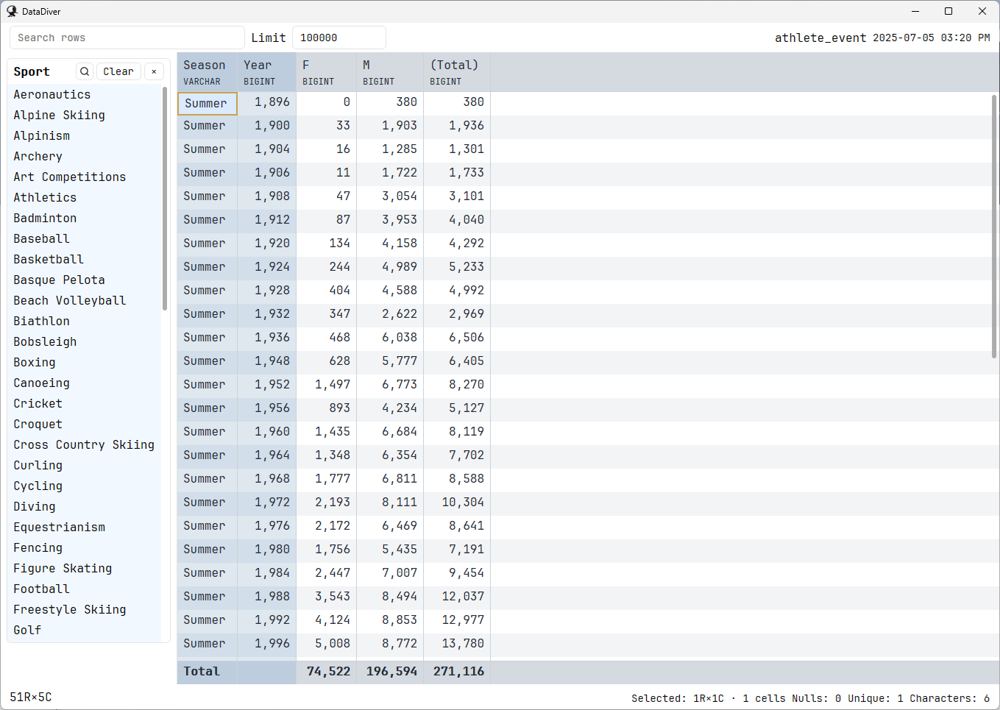
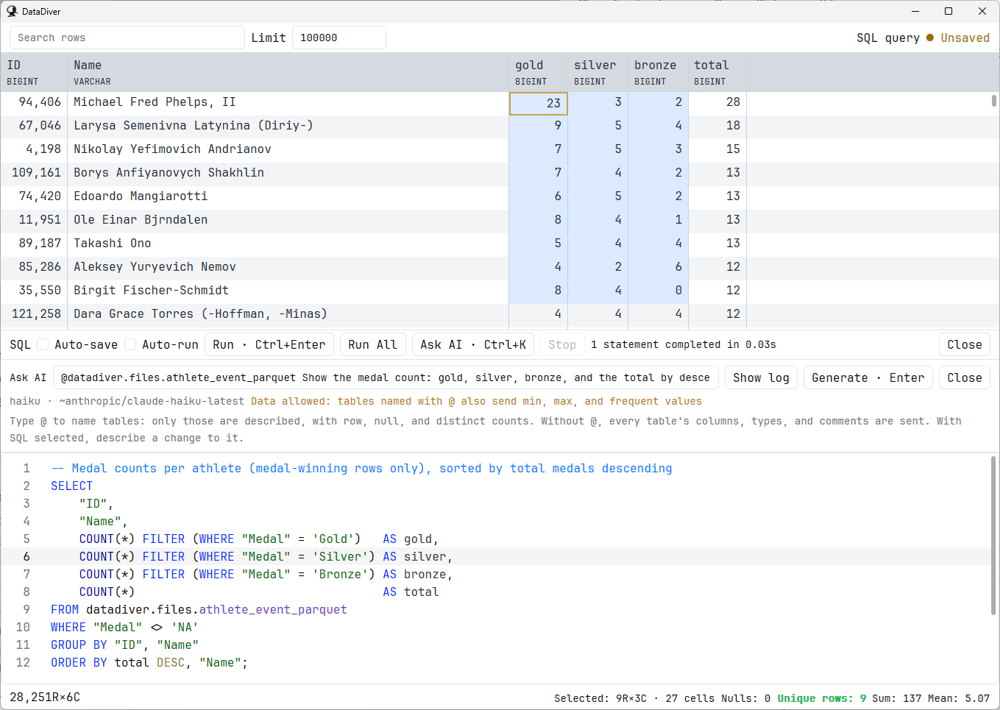

# DataDiver

A native desktop app for fast data exploration and quick lookups. Open a data file, search and filter rows, build a pivot, etc.

DataDiver is built in Rust with two query engines, Polars and DuckDB, and draws its own Windows UI with Direct2D and DirectWrite. The focus is an efficient, enjoyable workflow: responsive tables, keyboard commands, and reusable views.




- [Features](#features)
- [Install](#install)
- [A typical workflow](#a-typical-workflow)
- [Keyboard shortcuts](#keyboard-shortcuts)
- [Opening data](#opening-data)
- [Query engines](#query-engines)
- [Search](#search)
- [Slicers](#slicers)
- [Filters and drill-down](#filters-and-drill-down)
- [Group By, Pivot By, and aggregations](#group-by-pivot-by-and-aggregations)
- [Working with the grid](#working-with-the-grid)
- [Copy and export](#copy-and-export)
- [SQL editor](#sql-editor)
- [Ask AI for SQL](#ask-ai-for-sql)
- [View actions](#view-actions)
- [History and undo](#history-and-undo)
- [Customization](#customization)
- [Command-line options](#command-line-options)
- [File formats and local storage](#file-formats-and-local-storage)
- [Build from source](#build-from-source)
- [Development](#development)

## Features

- **Open local data:** CSV, TSV, Excel (`.xlsx`), and Parquet. Add whole folders, paste a table from the clipboard, drop files on the window, or attach a DuckDB or SQLite database.
- **Two query engines:** each file is read by Polars, which loads files into memory fast, or DuckDB, with its full SQL in expressions and cards. Polars is the default; choose per file.
- **Browse the database:** a sidebar tree of saved views, database tables and views, attached databases, and watched files and folders.
- **Explore tables:** search with a small query language, sort, filter with slicer cards, freeze and hide columns, and inspect selection statistics.
- **Build pivots:** group by columns or SQL expressions, pivot by dimensions, and aggregate with count, sum, mean, median, minimum, maximum, or any aggregate the file's engine has. Add grand totals.
- **Conditional formatting:** color, bold, data bars, color scales, icons and sparklines from short rules like `if duplicate(c) then bg: mistyrose`, with presets and completion.
- **Drill down:** press **Enter** on a pivot cell to see the source rows behind it.
- **Write SQL:** a SQL editor with highlighting, table, column, and file path completion, SQL sources whose rows you can build views on, SQL scripts, and a startup script.
- **Ask AI for SQL:** describe what you want and get SQL checked by DuckDB before you run it, using any OpenAI-compatible provider.
- **Inspect values:** column profiles in the Info dialog, and a cell detail pane for long text and pretty-printed JSON.
- **Reuse your work:** save views, open favorites with **Ctrl+1–9**, go back and forward through history, undo view changes, and restore the previous session.
- **Copy and export:** copy cells as TSV, CSV, JSON, or Python lists, or export the displayed result to CSV, Parquet, JSON, or Excel.
- **Look things up:** view actions open a web page, internal site, or program for the active row.
- **Work from the keyboard:** a searchable command palette, a Helper menu (**Space** or **Ctrl+K**) that lists the grid's shortcuts, and a Keymap Editor for custom shortcuts.
- **Make it comfortable:** themes, grid and editor fonts, font size, and independent windows.

## Install

DataDiver currently ships for 64-bit Windows.

Download the zip from the [Releases page](https://github.com/ryanwd123/datadiver/releases), extract it, and run `datadiver.exe`. No installer or other software is needed. The exe is unsigned, so Windows SmartScreen may warn the first time you run it.

It can also be installed with [pipx](https://pipx.pypa.io/), which puts `datadiver` on your PATH:

```powershell
pipx install datadiver
datadiver
```

Upgrade later with `pipx upgrade datadiver`.

To try the app with generated data and a temporary profile that leaves nothing behind:

```powershell
datadiver --rows 10000 --ephemeral
```

## A typical workflow

1. Press **Ctrl+O** to open a supported file, or **Ctrl+P** to browse files and saved views.
2. Press **/** to search the displayed rows. Press **Z** to add a slicer that filters by a source column.
3. Press **G** to choose grouping columns, **A** to configure aggregations, and **P** to choose pivot dimensions. Use **O** to configure ordering.
4. Press **Enter** on a result cell to see the rows behind it, and **U** to go back.
5. Select cells and press **Ctrl+C** to copy, or **Ctrl+Shift+C** to choose an output format.
6. Press **Ctrl+S** to save the view for later.

Press **F1** for a list of shortcuts, or **Ctrl+Shift+P** to search every command.

## Keyboard shortcuts

These are the defaults. Single-key commands apply when the grid has focus. Change any of them in the Keymap Editor (**Ctrl+Shift+K**), which supports separate bindings per context.

**Application**

| Shortcut | Action |
| --- | --- |
| Ctrl+Shift+P | Command palette |
| Ctrl+, | Settings |
| Ctrl+P | Files and views |
| Ctrl+O | Open file |
| Ctrl+B | Show or hide database tree |
| Ctrl+J | Open SQL editor |
| Ctrl+S or F12 | Save view |
| Ctrl+1–9 | Open a favorite |
| Ctrl+Shift+1–9 | Assign the current file or view to a favorite |
| Ctrl+Z / Ctrl+Y or Ctrl+Shift+Z | Undo / redo view change |
| Ctrl+R | Reload source |
| Ctrl+Shift+R | Reload and reset |
| Ctrl+F | Focus search |
| Ctrl+D | Focus data grid |
| Ctrl+L | Focus next slicer input |
| Ctrl+G | Jump to column |
| Ctrl+= / Ctrl+- | Increase / decrease font size |
| Ctrl+N | New window |
| Ctrl+Q | Close window |
| Ctrl+Shift+K | Keymap Editor |
| F1 | Help |

**Grid**

| Shortcut | Action |
| --- | --- |
| / | Search |
| Space or Ctrl+K | Open the Helper menu |
| G / A / P / O | Group By / Aggregations / Pivot By / Order By |
| Z | Add slicer |
| = / - | Keep / exclude rows equal to the active cell |
| Enter | Drill down from a query cell to its source rows |
| Shift+Enter | Drill down in a new window |
| U / R | Back / forward |
| [ / ] | Sort ascending / descending |
| Shift+X | Clear sort (tables) |
| F / Shift+F | Freeze or unfreeze column / unfreeze all |
| Alt+← / Alt+→ | Move the selected columns left / right (tables) |
| Delete | Remove the active group-by column (queries) |
| ( / ) | Decrease / increase the selected columns' widths |
| < / > | Decrease / increase decimal places of the selected columns |
| , | Toggle thousands grouping of the selected columns |
| T | Show or hide totals (queries) |
| M | Conditional formatting |
| D | Show or hide cell detail |
| N | Drop files to watch |
| I | Information and column profiles |
| Ctrl+C or C | Copy selection |
| Ctrl+Shift+C | Copy as… |
| Ctrl+V | Open table from clipboard |

**Helper menu** (press **Space** or **Ctrl+K**, then the key). The menu also lists the grid keys above, so it doubles as a reminder of them; click any entry to run it.

| Key | Action |
| --- | --- |
| C / Shift+C | Copy / copy as… |
| S | Save |
| / | Search |
| G / A / P / Z | Group By / Aggregations / Pivot By / Add slicer |
| E | Export result to file |
| T | Show or hide totals (queries) |
| M | Conditional formatting |
| H / Shift+H | Hide selected columns / show or hide columns (tables) |
| X | Run view action |

## Opening data

- **Files:** **Ctrl+O** opens CSV, TSV, Excel, and Parquet files. A path on the command line works too. A file opens as a table read into memory by its [query engine](#query-engines), so it can be scrolled, sorted, and filtered whole. Opened files are remembered under **Recent files**.
- **Watched files and folders:** watched files are listed under **Sources** for quick opening; nothing is read until you open one. Press **N** in the grid and drop files on the overlay, or use **Add watched files** in the command palette, to watch single files. **Add folder** watches a whole folder, and its supported files appear under **Ctrl+P** and in the database tree. Each watched file also gets a view in the profile database's `files` schema, so SQL can read it as `files.<name>` (see [File views](#file-views)).
- **Clipboard:** **Ctrl+V** in the grid saves pasted text, such as cells copied from Excel or a web page, as a TSV or CSV file and opens it like any other source. Files copied in Explorer open directly.
- **Drag and drop:** dropping files on a window opens the first one there and the rest in new windows. Dropping a DuckDB or SQLite database attaches it read-only and shows it in the database tree. To write to it, run `DETACH name; ATTACH 'path' AS name;` in the SQL editor.
- **Database tree:** **Ctrl+B** opens a sidebar that lists saved views, SQL scripts, tables and views in the profile database and any attached databases, SQL sources, watched files and folders, recent files, and DuckDB's `duckdb_*()` metadata functions. Type to filter, press **Enter** to open, or **Shift+Enter** to open in a new window. The refresh button picks up tables created while it is open.
- **Deleting from the tree:** **Delete** removes what the selected item stands for. A saved view is archived, a recent file is forgotten, a watched file or folder stops being watched, and an attached database is detached. A table or view in the profile database is dropped after you confirm. Folders are watched whole, so deleting a file inside a watched folder offers to stop watching the folder; to leave files out, move them out of the folder.
- **Favorites:** **Ctrl+Shift+1–9** assigns the current file or view to a slot, and **Ctrl+1–9** opens it.

The end of the search row shows the open file or view, **● Unsaved** when it has changes, and when its file was modified. The gear after it opens **View options** (also in the command palette), the settings that apply to what is open: the query engine, **Read mode** and **Preserve order** for a file, **Auto-save**, **Auto-run** for SQL, and the slicer options. **Enter** switches an option in place. With **Auto-save** on, a saved view stores each change two seconds after you make it, and before the window opens something else or closes; turning it on for an unsaved view asks for a name first.

## Query engines

Every file is read by one engine, and everything you do with it, from search and slicers to group-by, pivots, totals, and export, runs in that engine.

- **Polars** (the default) reads files into memory very quickly, and every window showing an unchanged file shares one copy. SQL cards and custom expressions use Polars SQL, which covers common functions plus the `year()`, `month()`, and `date_trunc()` shorthands.
- **DuckDB** reads the file into an in-memory table, which is slower for large files, but SQL cards and custom expressions can use all of DuckDB's SQL. Nothing is written to the profile database. To query a file from the SQL editor, watch it and use its view, such as `files.sales_csv`. **Preserve order**, in **View options**, keeps rows in file order; turning it off reads large files faster.

**Read mode**, in **View options** or the command palette, decides whether a file is read into memory at all. **In memory** (the default) reads it with the file's engine as above. **Scan** leaves the file where it is: it opens as a query that DuckDB reads in place on every run, so files too big to hold still group, pivot and filter; queries read the file again each time, so they are slower than in memory, and the rows show in query mode rather than table mode. The choice is kept with the file, and views saved while scanning keep scanning.

Switch a file with **Query engine** in **View options** (the gear at the end of the search row), or use **Choose query engine**. The choice is kept with the file, and saved views of the file follow it. **Settings** (**Ctrl+,**) sets the default engine for files without their own choice. A SQL source or script chooses its engine the same way: **DuckDB** runs all of DuckDB's SQL against the profile database and attached databases, and **Polars** runs Polars SQL, which reads files with `read_csv('…')`, `read_parquet('…')` and the like; tables one statement creates stay for later runs in that editor. Views built on a SQL source use its engine. Database tables, attached databases and the startup script always use DuckDB. The editor's completion and checks follow the chosen engine: on Polars it offers Polars SQL's functions, types and syntax, and the tables earlier runs created.

## Search

Search words must all appear in a row (any column, case-insensitive). `-word` excludes rows containing it, and `>N`, `<N`, `>=N`, `<=N` match rows where any numeric column compares true.

Scope a term to one column with `column:text` (contains), `column=value` (equals), `column!=value`, or `column>N` / `>=` / `<` / `<=`. Number columns compare numerically, and dates and other types compare as that type, so `"order date">=2024-01-01` works. The column name can be any unique prefix (`reg:north` for `region`); quote names or values with spaces (`name:"john smith"`). `-column:text` excludes, and a name matching no column searches the whole word as text, so `10:30` still finds times.

Compare two columns by putting the second column's name in double quotes after the operator: `"small bags">"large bags"`. Typing `"` lists matching column names; press **Tab** or **Enter** to insert one.

Search words are highlighted in visible cells; column-scoped words are highlighted only in their column. While search or filters narrow the rows, the status bar shows **N of M rows**. Press **Ctrl+G** to find a column by name and move the cursor to it.

## Slicers

**Add slicer** (**Z**, or **Space Z**) offers three kinds of card:

- **SQL filter** is always first in the list, and a view can have one. Type any SQL condition (in the file's [engine](#query-engines)) over the source columns and press **Enter**, for example `amount > 100 AND region <> 'Europe'` or `amount % 2 = 0`. The card is not tied to a column.
- **Value cards** list a column's values when it has at most 1,000 of them. Click, Ctrl+click, or drag to select. The search icon in the card header opens a filter box: type to narrow the list, press **Enter** to select every matching value, and **Esc** to close it. Values are greyed out when no row matches the other slicers and the `=` / `-` filters, but search does not grey them out.
- **Condition cards** (listed as *column · condition*) work for any column. Type a condition and press **Enter**. Terms are separated by spaces and must all match: `>=10 <100`, `=North`, `!=0`, `:smith` or a bare word (contains), `-word` (does not contain), and inclusive ranges `10..20`, `2024-01-01..`, `..500`. Numbers compare as numbers and dates as dates. Text ranges ignore case and include every value starting with the upper bound, so `china..italy` includes "Italy". Partial dates cover their whole period, so `2024-10` is all of October and `..2024` runs through December 31, 2024. Comparison values can be relative dates: `today`, `yesterday`, `-30d`, `+2w`, `-6m`, `-1y` (so `-30d..today` is the last 30 days). The card shows the column's smallest and largest value.

Two slicer options in **View options** are kept with the file. **Cross filter** greys out values as described above; turning it off shows every value as available and skips those queries, which is faster on big sources. **Available first** lists available values before greyed-out ones.

If a condition or SQL filter has an error, the error shows on its card and the card stops filtering until you fix it. **Ctrl+L** moves through the slicer inputs, and **Ctrl+D** returns to the grid.

Slicers, condition cards, the SQL filter, and `=` / `-` filters all narrow source rows, before grouping in a query. Search narrows the displayed rows. In a query, search and sort apply to the result.

When a query result reaches the row limit, the limit input turns red and the status bar says **Limited to N rows**. Search and sort then run inside the query, so they still see every result row, not just the first N.

The same **Limit**, one setting for every window, also caps how many rows of a file are read into memory, so a file too big for the machine never fills it. The input shows beside the search whenever a file is read into memory. When the file has more rows than the limit, only the first N are read, the limit input turns red, and the status bar says **Read the first N rows of the file**; groups, pivots and totals then cover only those rows. Raise the limit to read more, or switch the file's **Read mode** to **Scan** to group and aggregate every row in place without reading it into memory.

## Filters and drill-down

Press **=** in the grid to keep only rows whose value in the active column equals the active cell, or **-** to exclude them. With several cells selected, each selected column is filtered to (or from) the values selected in it, shown as `in (…)` or `not in (…)`. Pressing **-** again on the same column adds the value to its `not in` filter rather than making a new one; excluding an empty cell is a filter of its own, `is not null`, and excluding values keeps empty cells. Filters match the value as the grid shows it before number formatting, including empty (NULL) cells. In a query, **=** and **-** work on group-by cells and filter the source rows before grouping. Active filters appear as chips under the header; click a chip to remove it, or use **Clear filters**. Filters are saved with a view.

In a query result, press **Enter** on a cell to open the source table filtered to the rows behind it: the row's group-by values, plus the pivot values when the cell is a pivoted measure. The query's slicer selections and filters carry over. Press **U** (Back) to return to the query, or use **Shift+Enter** to open the drill-down in a new window and keep the query where it is.

## Group By, Pivot By, and aggregations

Press **G**, **P**, and **A** to open the Group By, Pivot By, and Aggregations managers. You can configure pivot dimensions first, then add a group to build the result.

Group By and Pivot By each provide **+ Custom expression** and an SQL editor for the selected entry. For example, group by `date_trunc('month', "date") AS month` or pivot by `upper("region") AS RegionCode`. Expressions use source columns; aggregates and window functions belong outside these row-level dimension expressions. Use `AS` for a result name or keep DuckDB's default name. Typing `"` in these editors lists column names, ranked like the search box; typing a word lists the columns, keywords and (for DuckDB files, in the aggregation editor) aggregate functions it starts, and only what the file's engine supports. SQL cards list column names after `"`.

The Aggregations manager has a **Columns / Functions** switch. **Functions** lists the aggregates of the file's engine (every DuckDB aggregate, or those Polars SQL has), searchable by name or description, with signatures and examples; press **Enter** to insert one into the expression. Turning a structured aggregation into a custom one writes its SQL in the same engine's dialect.

Apply with **Ctrl+Enter**, or use **Revert** to restore the saved entry. Invalid edits show an inline error and preserve the last successful grid. **Tab/Shift+Tab** cycles between available columns, configured entries, and SQL; **Alt+↑/↓** reorders and **Delete** removes a configured entry. Managers stay open for further edits; close with **Escape** or the close button.

- **Totals** (**T**) add a grand total row under the grid and, for pivots, a **(Total)** column for each row. Totals aggregate the source rows, so means, medians, and distinct counts total correctly.

## Conditional formatting

Press **M** (or **Space M**) in the grid to open the formatting manager. It opens in a window of its own that you can move and resize beside the grid, and it comes back where you left it relative to the main window. A view has any number of format sets, each rules and the columns they apply to; the active column's set opens first. Rules are written in a small language and separated by `;`:

```text
if duplicate(c) then bg: #ffc7ce, text: #9c0006;
if c > "target" then bold, border: 1px green;
if c > 0 then icon: up elif c < 0 then icon: down;
scale(red, white, green, mid=0);
bar(steelblue, fill=gradient)
```

`c` is the cell, `"name"` another column of the row, and `'text'` text. Pick a preset from **Add a preset** to add its rule, press **Ctrl+Space** for what can come next, type `"` for column names and `#` for colors (with a color picker). Problems are underlined and listed under the rules. Changes show in the grid as you type. Whole-column tests such as duplicates, ranks, averages and color scales count the rows the slicers and filters leave, not a search's. A plain file remembers its formats; a view saves them. The language is described in [crates/diver_format/README.md](crates/diver_format/README.md).

Views store the source path and the exploration configuration. They reference the original source file, so sharing a view also requires making that source available.

## Working with the grid

- **Selection statistics:** the status bar summarizes the selected cells. With several columns selected, **Unique rows** counts distinct combinations and turns green when every selected row is distinct, a quick check that the columns form a unique key.
- **Columns:** freeze with **F** (**Shift+F** unfreezes all), reorder tables with **Alt+←/→** (the selected columns move together and stay centered in view), hide the selected columns with **Space H**, and choose visible columns with **Space Shift+H**. Hidden columns keep their place in the column order, and a `column:` search term still searches them. **Recalculate column widths** in the command palette refits every column to its contents, headers, and totals.
- **Number formatting:** **,** toggles thousands grouping and **<** / **>** change decimal places for every selected column; **(** / **)** narrow or widen them.
- **Cell detail:** **D** opens a pane beside the grid with the active cell's whole value, following the cursor. JSON objects and arrays are pretty-printed.
- **Information:** **I** opens the Info dialog with column profiles: nulls, unique count, minimum, maximum, and the five most frequent values for every column, plus the SQL behind the view.

## Copy and export

**Ctrl+C** copies the selection as TSV. **Ctrl+Shift+C** chooses a format: TSV (raw or formatted), CSV, JSON records, JSON columns, or Python lists.

**Export result to file** (**Space E**) writes the rows on screen, matching the search, filters, sort, column order, and hidden columns. The file extension picks the format: `.csv`, `.tsv`, `.parquet`, `.json`, `.ndjson` / `.jsonl`, or `.xlsx`, with `.gz` or `.zst` compression for text formats. A query result cut off at the row limit is rerun without the limit, so the file is complete.

## SQL editor

Start with **New SQL source** or **New SQL script** in the command palette, which open the editor in a resizable panel below the grid. **Ctrl+J** (**Open SQL editor**) shows it again for the open SQL source or script, or, on the rows of a SQL source or a view built on one, opens that source in the editor; other views have no SQL to edit. **Ctrl+Enter** runs selected SQL, or the statement at the cursor; **Ctrl+Shift+Enter** or **Run All** executes the script in order. **Stop** interrupts execution. The grid shows the last result set and keeps search, sorting, navigation, and copy/export available without running SQL again.

SQL runs on DuckDB against the active profile database, and can read files with `read_csv('path')`, `read_parquet('path')`, or a watched file's view, `files.<name>`. Database changes are allowed. Temporary objects and explicit transactions survive between runs in the same SQL document. Run All stops on the first error and follows DuckDB's normal transaction behavior. The row limit caps captured results, including `RETURNING`, without limiting writes; a changed limit applies on the next run.

When the script's last statement is a plain query run outside a transaction, the whole result is kept, so slicers, `=` / `-` filters, search, and sort see every row. Other results keep only the rows up to the limit, and slicers and filters explain why they are off.

The editor works like VS Code's: multiple cursors (**Alt+Click**, **Ctrl+Alt+Up/Down**, **Ctrl+D**, **Ctrl+Shift+L**), column selection (**Shift+Alt+drag**), **Alt+Up/Down** to move lines, **Ctrl+/** to comment, **Ctrl+Shift+K** to delete a line, **Ctrl+G** to go to a line, **Ctrl+F** / **Ctrl+H** for find and replace with case, whole word, and regex, folding, bracket matching, and **Ctrl+wheel** to zoom. Right-click for the context menu. **Ctrl+Enter** still runs SQL, and **Ctrl+K** asks AI. These keys are in the keymap editor's **SQL Editor** context, so they can be rebound, and the command palette lists the editor's actions while it is open.

The editor understands DuckDB's SQL as you type:

- **Completion** offers what fits the cursor: statement keywords, then tables, views, schemas and databases after `FROM` or `JOIN` (other databases' tables under their qualified names), columns of the tables in scope (including CTEs, subqueries, `t(a, b)` aliases and tables the script creates), functions, types after `CAST(x AS`, settings after `SET`, and extensions after `LOAD`. Typing `a.` lists the columns of alias `a`, wherever the alias is written in the statement, and `"` lists names to quote. Typing a path inside a `'...'` string lists matching folders and files; relative paths search DuckDB's `file_search_path`. **Ctrl+Space** opens the list by hand. Use **Enter** or **Tab** to accept a suggestion.
- **Highlighting** colors tables, columns, functions and keywords by their place in the statement, so a keyword used as a column name colors as a column.
- **Problems** are underlined once typing pauses: syntax errors, unterminated strings and comments, and tables neither the database nor the script knows. Rest the mouse on one to read it.
- **Hover** over a statement keyword for its syntax, or over a table, column or alias to see what it refers to.
- **Signature help** shows the function being called and highlights the argument being typed, after `(` or `,`, or with **Ctrl+Shift+Space**.
- **Folding** and **Shift+Alt+Right** (expand selection) follow the statement's structure.

**Escape** closes suggestions and signature help, clears extra cursors or the selection, and then returns focus to the grid.

**Settings** (**Ctrl+,**) › **Editor options** changes how the editor looks and behaves: the completion list's font, size and number of rows; whether completions and signature help open while typing; problem underlines and hover docs; word wrap, line numbers, whitespace, indent guides and highlights; closing brackets and quotes; the blinking cursor; tab size, spaces or tabs, and indentation detection; and Ctrl+wheel zoom. The options are saved with your settings and apply to every window.

Save SQL with **Ctrl+S**. A saved SQL is a **SQL source**: it is listed under **Sources › SQL sources** in the database tree and in **Ctrl+P**, and opening it there shows the rows its last statement returns, as a table you can search, slice, group, pivot and save views of like any other source. Each such view runs the script again, on a connection of its own, when it opens or reloads (**F5**), so the script should create only temporary tables, or use `CREATE OR REPLACE`. Group By, Pivot By, Aggregations and Order By in the editor of a saved SQL source open its rows the same way. In the editor, a SQL source reopens without execution unless you turn on **Auto-run** in **View options**.

A **SQL script** is a scratchpad for statements you run now and then, such as maintenance or one-off checks. Scripts are listed under **SQL scripts** in the database tree and in **Ctrl+P**, and open in the editor; views are not built on them. Results and temporary objects are not saved. Closing the panel keeps its text and connection while the document remains open. **F** freezes leading result columns, and the view remembers them.

**New SQL source** and **New SQL script** in the command palette start an empty one in the editor, even when the editor is already open.

**Open startup SQL script** in the command palette edits `duckdb_startup.sql`, which runs whenever the profile database opens. Use it for settings and attachments you always want, for example:

```sql
ATTACH 'C:\data\warehouse.duckdb' AS warehouse (READ_ONLY);
SET file_search_path = 'C:\data';
```

**Reset database connection** starts the DuckDB session over without restarting the app: it detaches every attached database, runs the startup script again, and gives the SQL editor a new connection, which drops its temporary tables and `SET` options. Use it after editing the startup script.

## Ask AI for SQL

In the SQL editor, press **Ctrl+K** (or **Ctrl+I**, or choose **Ask AI for SQL**) to open a prompt above the editor. Describe what you want and press **Enter**. If you select SQL first, the request asks for that selection to be rewritten. DuckDB checks the reply against the database, and errors go back to the model to be fixed, up to twice, before the SQL is shown with DuckDB's verdict. Press **Tab** to insert it at the cursor, **Ctrl+Enter** to insert and run it, or **Escape** to discard it. **Show log** lists every request and reply.

Type **@** to mention a table. When the prompt names tables, only those are described in detail.

**Set up a provider** with **AI providers** in the command palette. Any OpenAI-compatible chat API works: enter a base URL, model, and API key, plus any extra headers your gateway needs. The key can be written as `{env:NAME}` to read it from an environment variable instead of storing it in `settings.json`. **Test connection** sends a one-line request to check the settings.

**What is sent:** your request, the SQL in the editor (or the selection), the current result's column names, and the names, types, and comments of tables and columns. For @-mentioned tables, row counts, null shares, and approximate distinct counts are added. Actual data values are sent only when **Allow sending data to improve SQL output** is turned on for the provider. It then adds minimum and maximum values, every value of columns with 25 or fewer distinct values, and the five most frequent values of other text columns, for @-mentioned tables only.

## View actions

Actions turn the active row into a lookup: open a web search, a record in an internal site, or a file in another program. Press **Space** then **X** to show the view's actions, then press an action's key to run it for the active row. With no actions yet, **Space X** (or **Edit view actions** in the command palette) opens the editor, where each action has a single-character key (case-sensitive), a description, and a command.

In the command, `{Column}` inserts the active row's value for that column, and `{{` / `}}` insert literal braces. Commands starting with `http://` or `https://` open in the browser, with inserted values URL-encoded, for example `https://www.google.com/search?q={Customer}`. Any other command starts a program directly without a shell: the first word is the program, double quotes group an argument (`code "C:/notes/{Id}.md"`), and an inserted value always stays inside its argument. For shell features such as pipes or `start`, write the shell yourself (`cmd /C start "" "{Path}"`).

In the editor, a preview under the command shows it filled in with the active row's values, **Run** tries the command in the form without saving it (each saved action has its own **Run** too), and **Use** loads one of the examples into the form. Actions are saved with the view, so save it (**Space S**) to keep them.

## History and undo

Press **U** in the grid to go **Back**, or **R** to go **Forward** through files and views opened in that window. History remembers the current view configuration (including unsaved changes) and search text, with up to 100 entries until the window closes. It stores no data or result tables: returning rebuilds table and pivot results from the source, while SQL text reopens without execution or prior results. Opening another view after going back replaces the forward branch.

**Ctrl+Z** and **Ctrl+Y** undo and redo changes to the view: group-by, pivot, aggregations, totals, sort, slicers, filters, and column layout. Undo history starts over when you open something else or save. Text inputs keep their own **Ctrl+Z**.

## Customization

- **Settings** (**Ctrl+,**): the default query engine, fonts, theme, shortcuts, AI providers, the DuckDB startup script, and the settings folder in one list.
- **Keymap Editor** (**Ctrl+Shift+K**): rebind any command, per context.
- **Theme Editor**: adjust the theme's colors.
- **Font picker** and **Choose editor font**: set the grid font and the monospaced font used by the code editors. **Ctrl+=** and **Ctrl+-** change the size of both.
- **Open settings directory**: opens the profile folder in File Explorer.

## Command-line options

```powershell
# Open a source file; a positional path also works.
datadiver --file "C:\data\sales.parquet"

# Open a saved view.
datadiver --view "C:\views\sales-summary.json"

# Open a file with an initial search and column slicer.
datadiver --file "C:\data\sales.csv" --search "North" --slicer "Region"

# Use a separate persistent profile.
datadiver --home ".\demo-profile" --rows 10000
```

| Option | Purpose |
| --- | --- |
| `--file PATH` | Open a supported source file |
| `--view PATH` | Open a saved JSON view |
| `--rows N` | Generate synthetic data |
| `--search TEXT` | Set the initial row search |
| `--slicer COLUMN` | Add a source-column slicer; may be repeated |
| `--home DIRECTORY` | Store all profile files directly in this directory |
| `--ephemeral` | Use a temporary profile |
| `--no-restore` | Skip restoring the previous session and window geometry |
| `--window WxH` | Set the initial window size |
| `--help`, `-h` | Print basic usage |

Choose one of `--file`, `--view`, or `--rows` per launch. `--home` and `--ephemeral` cannot be combined. With no explicit source, the app attempts to restore the last source or view.

## File formats and local storage

CSV and TSV files use a header row and automatic type detection. Excel files are read from the first worksheet with a header row. Older `.xls` files, `.xlsb`, and `.ods` are not supported. With the DuckDB engine, the first Excel file or export may need internet access for DuckDB to download its `excel` extension.

Files are read into memory each session; nothing is kept on disk. Source changes are detected using file size and modification time. Open windows check on activation and every second, then refresh their grids and pivots when the data changes; **Ctrl+R** reads the file again.

With the DuckDB engine, each file has one table in an internal in-memory catalog while a window shows it, which SQL completion doesn't offer.

### File views

The profile database keeps a view of each watched file, and of each supported file in a watched folder, in its `files` schema: `sales.csv` becomes `files.sales_csv`. Names are lowercase, with punctuation replaced by underscores; a second file with the same name gets a number, such as `files.sales_csv_2`, in path order. A view reads its file each time it is queried, so it always shows the file as it is now, and it works from any DuckDB client that opens the profile database. Views follow the watched files and folders: they are made when a window opens and when you watch or stop watching something, and while the database tree is open, when files come or go in a watched folder. DataDiver changes only the views it made, so your own objects in `files` stay. **DuckDB: views of watched files** in **Settings** (**Ctrl+,**) turns them off, which drops them; it is on by default.

On Windows, the profile is stored in `%LOCALAPPDATA%\datadiver`; other platforms use `~/.local/share/datadiver`. Custom `--home` profiles store everything in the specified directory. The profile contains:

| Path | Contents |
| --- | --- |
| `datadiver.duckdb` | Anything you create in SQL |
| `settings.json` | Preferences, favorites, and AI providers |
| `keymap.json`, `theme.json` | Custom shortcuts and theme |
| `duckdb_startup.sql` | The startup SQL script |
| `state.json` | Session state restored at startup |
| `views/` | Saved views; archived views move to `deleted/` |
| `pasted/` | Tables opened from the clipboard |

## Build from source

The project has been developed and tested on Windows. The commands below use PowerShell.

You will need:

- A current stable Rust toolchain with Cargo and Rust 2024 edition support.
- For Windows builds, the MSVC Rust target, Visual Studio C++ Build Tools, and the Windows SDK.
- Internet access to download Cargo dependencies for the first build.

DuckDB is compiled from bundled source, so a separate DuckDB installation is not required. The first build can take a while because it includes native dependencies.

From the repository root:

```powershell
cargo build --release
.\target\release\datadiver.exe
```

To try the app with generated data:

```powershell
cargo run --release -- --rows 10000 --ephemeral
```

## Development

Run the regular tests and the tests with UI snapshot support:

```powershell
cargo test
cargo test --features snapshots
```

The app can capture its own UI when built with the `snapshots` feature:

```powershell
cargo run --features snapshots -- --rows 60 --show info --capture "target\ui\info.png" --ephemeral
```

Use `--window 1400x900` to specify capture dimensions and `--capture-delay 1000` to set the capture delay in milliseconds. Other `--show` targets include `editor:sql`, `editor:sql-results`, `editor:sql-completion`, `editor:sql-error`, `editor:sql-ask`, and `ai-providers`.

The source is organized into:

- `src/domain`: data models, pivots, selection, formatting, and copy formats.
- `src/application`: application state, commands, preferences, and editing workflows.
- `src/infrastructure`: the DuckDB and Polars stores, source reads, persistence, and performance instrumentation.
- `src/ui`: the table interface, panels, editors, and palettes.

For measured performance results and implementation details, see the [storage comparison](performance/STORAGE.md), [query modes](performance/QUERY_MODES.md), and [table width behavior](performance/TABLE_WIDTHS.md).

### Releasing

From a clean `main`, run:

```powershell
.\scripts\release.ps1 0.2.0
```

The script sets the version in `Cargo.toml`, runs the tests, commits, tags `v0.2.0`, and pushes. The tag starts the Release workflow, which builds the Windows wheel with [maturin](https://www.maturin.rs/) using the optimized `dist` profile, attaches it and a zipped exe to a GitHub release, and publishes the wheel to PyPI. To check the wheel locally, run `maturin build --release` and `pipx install target\wheels\datadiver-*.whl`.
