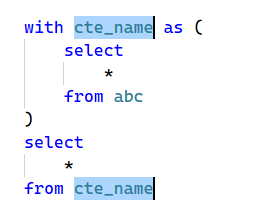

### Text editor features
- show helper menu with ctrl-k
    - Currently, Control-K brings up the Ask AI panel. We will change that to be corded. So when you press Ctrl K, then in the helper menu that shows up, we will put A with Ask AI. 
- Other items for SQL editor helper menu. 
    - c: move current select node to CTE
        - If there's already a CTE, this will add the current select statement to the bottom of the CTE and then add a new select statement that says just select * from the new CTE. And then let's make it so that it puts in a placeholder CTE name and then positions it with multiple cursors so that when you are naming the CTE, it's also updating the from statement below.
        - 
    - t: Run the current select node. 
        - This will be used to be able to inspect the results of CTEs in subqueries within a larger query. When this gets run, it needs to be smart enough. Like, let's say this is the third CTE. To execute that, it needs to be smart enough to build a query that includes the prior CTEs that it may depend on. 
    - f: format sql

### Suggested additions (Claude, for review)

#### Notes on the items above
- "Current select node" should mean one thing for every item below: the
  innermost query that holds the caret — a CTE body, a subquery, or the
  statement's top-level select. Flash a highlight on it when a menu item acts
  on it, so it's clear what was picked. Pressing the key again could widen to
  the next enclosing query, like Shift+Alt+Right does for syntax nodes.
- c (move to CTE): if the caret is in a subquery in FROM, as in
  `(select ...) as t`, lift it into a CTE named `t` and leave `t` in its place,
  with no placeholder needed. Only the top-level select gets the `select * from`
  tail.
- c: the placeholder name and its uses act as linked fields: typing edits all
  of them, and Enter, Esc or Tab ends it. The editor has no snippet or
  linked-placeholder mode yet; building one also makes the snippets below
  possible.
- t (run node): include only the CTEs the node references, directly or through
  other CTEs, not every CTE above it. If the node is a correlated subquery,
  say it can't run alone and don't run it. Show the result in the grid labeled
  with the CTE name, and leave the editor text alone.
- f (format): the format in the screenshot puts each clause keyword on its
  own line with the clause body indented under it. With a selection, format
  only the selection. Comments must be kept. diver_sql has no formatter yet;
  it would work from the syntax tree.

#### More helper menu items (Ctrl+K, then…)
- i: inline CTE — the reverse of c. Replace each use with a subquery. If the
  CTE is used only once, remove it.
- w: wrap the current node as `select * from ( … )` and put the caret on the
  new outer select, to add a filter or aggregate on top.
- e: expand `*` under the caret into its column list, from the catalog or the
  columns a CTE resolves to. Shift+E collapses the list back to `*`.
- n: count the rows of the current node (`select count(*) from (…)`, with the
  CTEs it needs), and show the count in the status line instead of the grid.
- p: peek at the table or CTE under the caret: its first rows in the grid,
  without editing the query.
- d: describe the table or CTE under the caret: columns and types.
- x: EXPLAIN the current node. Shift+X runs EXPLAIN ANALYZE.
- g: add a GROUP BY for the select's non-aggregated items, or switch between
  that list and `GROUP BY ALL`.
- j: fill in the JOIN … ON under the caret from columns the two sides share
  (e.g. `customer_id`).
- l: add or remove `LIMIT 100` on the current statement.
- v: paste clipboard lines (e.g. a column copied from Excel) as an IN list:
  `('a', 'b', 'c')`, quoting the values unless they are all numbers.
  Shift+V pastes them as a `VALUES` table.
- o: outline. A list of the CTEs and statements to type-filter and jump to.
- h: history. Past queries run from this editor, with when they ran, how
  long they took and how many rows they returned. Enter puts one in the
  editor.
- u: change keyword case: UPPER, then lower.
- y: copy the current statement as a one-line string, ready to paste into
  Python or Rust.

#### Editor features (not in the menu)
- Go to definition (F12, or Ctrl+Click) for CTE names, table aliases and
  column aliases. Shift+F12 highlights the references.
- Rename (F2) a CTE, alias or column alias, with every reference updated in
  one undo step.
- Highlight the other uses of the identifier under the caret, as Monaco does.
- Shade the statement that Ctrl+Enter will run, so it's clear what runs
  before pressing it.
- When DuckDB reports an error with a position, show a squiggle there with the
  message and move the caret to it, instead of showing only the text in the
  status line.
- Sticky header: when scrolled into a long CTE, pin its `name as (` line at
  the top of the editor.
- Pipeline row counts: a command that runs each CTE and shows its row count
  as a faded hint at the end of its `as (` line, to find the step where rows
  are lost or duplicated by a join.
- Snippets with Tab stops (uses the linked-placeholder mode from c): `sel`,
  `join`, `case`, `window` (`… over (partition by … order by …)`), `pivot`,
  `cte`.
- Typing `select` or another keyword in lower case can stay as typed; the
  formatter and `u` handle case. There should be no autocorrect while
  typing.
